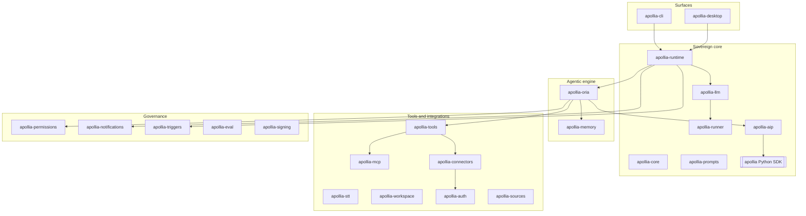

# 5. Building block view

This is the C4 container and component view. Apollia is a Rust workspace plus a
Python SDK, its crates grouped into five domains. Each crate below
carries a one-line role that matches what the code actually does. For the exact
shapes of the API, the CLI, and the SDK, this page links to the generated
reference rather than restating it.

## Containers by domain

The arrows show the main call directions, not every edge. The governance
decision and the audit trail, both inside `apollia-runtime`, sit on the path of
every tool call of an agent; the decision reads the rules, the consents and the
organisation policy that `apollia-permissions` stores. The
[Runtime view](/architecture/runtime-view) makes that concrete.

## Sovereign core

| Crate | Role |
|---|---|
| **apollia-runtime** | The daemon. Hosts the Tokio actor supervisor, the EventBus, the axum HTTP API, chat and plan management, and the signed audit journal with verification. |
| **apollia-runner** | The speech-to-text sidecar: `whisper` (via `whisper-rs`) out of process, one GPU backend per build. Local LLM inference no longer runs here; it goes through the embedded `llama-server` (upstream llama.cpp) that the daemon supervises, over an OpenAI-compatible HTTP API with `--jinja` native tool calling and continuous batching. |
| **apollia-llm** | The LLM router: the local engine plus remote backends reached through one OpenAI-compatible client (a self-hosted server, a gateway, Ollama), daily cost tracking, the embeddings client of the local engine, the model cards and their registry index, a Hugging Face GGUF registry, hardware detection, and the model recommender that ranks GGUF files for the local machine from their headers, their memory cost and the cards of the model registry. |
| **apollia-core** | Shared types: the unified plan model, configuration, lifecycle hooks, and the hybrid routing configuration that lets a run escalate to a frontier model on a user key. |
| **apollia-aip** | The PyO3 bridge: it imports the Python tools and workflows of installed packages, runs them in-process, and builds the `ctx` each one receives. |
| **apollia-prompts** | The English prompt corpus with a language footer, shared across the engine. |
| **apollia (Python SDK)** | AgentKit: the two decorators a package's Python is written with (`@tool` and `@workflow`), `TypedDict` schemas, the `describe` command that writes the tool and workflow descriptors of a package into its `apollia.toml`, and the test doubles (`MockContext`). It declares no agent: an agent is data in `apollia.toml`. The runtime context is the seventeen-service `ctx`. |

The `ctx` contract is `sdk/apollia/types.py` and is documented service by
service in the [SDK reference](/reference/sdk). The seventeen services are
`llm`, `memory`, `tools`, `agents`, `workflows`, `user`, `mail`, `datasources`,
`templates`, `secrets`, `events`, `logger`, `profile`, `workspace`, `stt`,
`notify`, and `budget`. Three of them, `agents`, `workflows` and `user`, are
bound in a workflow run only.

## Agentic engine

| Crate | Role |
|---|---|
| **apollia-oria** | The autonomous engine. It runs a ReAct loop in two modes, direct and orchestrated, with an observer that classifies and a reasoner that plans and re-plans. It carries the non-bypassable step budget, tool resilience, the verification and critic pass, three-tier context compaction, and read-only tool parallelism over a dependency graph. Spilling large tool results to disk is implemented but not installed on any execution path, so compaction is in-memory only. |
| **apollia-memory** | Three memory layers (episodic, semantic, procedural) over SQLite FTS5 with BM25 ranking, an injection tracker, TTL purge, a plan-choice store, and sovereign export and import. An agent reaches its own space, named after it and kept across its conversations and tasks, with the tools `memory_search` and `memory_write`: nothing is injected into its prompt and nothing is written on its behalf. |

## Tools and integrations

| Crate | Role |
|---|---|
| **apollia-tools** | The native tool library (shell, Python, file operations, notebook, HTTP fetch, web search and read, memory search and write, a profile proposal, ask-user), the family of action each tool declares, the manifest schema of a package, with a path sandbox, an SSRF guard, a SHA-256 audit of each call, and a shell command filter whose pattern lists ship empty and that no production code fills, so it blocks no command. |
| **apollia-mcp** | The MCP client (initialize plus tools/list over stdio, streamable HTTP, and SSE, with optional mDNS discovery). Agents invoke MCP tools through the governed tool path. The server side is a stdio bridge to the running daemon that serves the agents and workflows the user marked as exposed, and it is off by default. |
| **apollia-connectors** | Native Google and Microsoft connectors acting on mail, calendar, and files. Google is scoped to non-restricted, free-tier scopes; Microsoft is broader. Tokens go to the keyring or an age-encrypted file. |
| **apollia-stt** | Local speech-to-text on `whisper`: batch transcribe and translate plus an audio pipeline. Batch only, no streaming. |
| **apollia-workspace** | Project context (Git, an `APOLLIA.md` rules provider, a file tree, a script provider) and custom slash-commands: the harness layer around an agent. |
| **apollia-auth** | OAuth and PKCE flows backing the connectors, with secrets landing in the keyring or an age file. |
| **apollia-sources** | The sources an agent may consult once they are checked for it: indexed folders, files, mailboxes, the profile and memory. Holds the actor that owns their registry, a table of `system.db`; an agent's `sources` list names its identifiers, or `profile` and `memory`. |

For the full native tool list see the [native tool catalog](/reference/native-tools).

## Governance

| Crate | Role |
|---|---|
| **apollia-permissions** | What governance decides from: the fine rules (a tool and an optional argument prefix, scoped to one agent or to every agent), the standing consents an agent holds per family of action, the organisation policy and its verification, and the guard that lets a rule match a code executor on a single simple command only. The decision itself is taken in `apollia-runtime` (see [crosscutting concepts](./07-crosscutting-concepts.md)); the autonomy tiers are defined in `apollia-core`. |
| **apollia-notifications** | Operator notifications across desktop, terminal, and webhook, with severity, HITL, and an inactivity watcher. |
| **apollia-triggers** | Scheduled and reactive agent starts: cron, interval, one-shot and file-watch sources, and webhook triggers, which the runtime receives on `POST /webhooks/:id` and accepts under an HMAC-SHA256 signature. |
| **apollia-eval** | Sovereign evaluation: declarative TOML suites and success, length, wall-clock, and cost metrics. An `llm_judge` assertion exists in the suite schema but no judge is installed by the CLI, so such an assertion fails rather than being scored. |
| **apollia-signing** | Offline signatures: Ed25519 over a digest list for agent packages and organisation policies, and the verification of the minisign signatures the release pipeline puts on distribution metadata. |

The audit journal and verification that back accountability live in
`apollia-runtime`. See [the accountability model](/explanation/accountability-model)
for how they fit together, and [Audit and verify a run](/how-to/audit-and-verify)
for the commands.

## Surfaces

| Crate | Role |
|---|---|
| **apollia-cli** | The AI-native CLI: `do` (natural language to a validated command over the real command tree, dry-run and confirm, re-dispatched through governance), `explain` (read-only), `suggest` (deterministic, no LLM), a fuzzy palette, and a written `guide`. |
| **apollia-desktop** | The Tauri v2 and Svelte 5 operator app. Hundreds of Tauri commands across dozens of modules give an operator view over chat, MCP, connectors, tasks, memory, governance, notifications, and audit, reaching the backend through a direct handle or a local REST bridge. |

The command surface is the [CLI reference](/reference/cli); the HTTP surface the
desktop and hosts drive is the [HTTP API reference](/reference/api/apollia-os-runtime-api).
