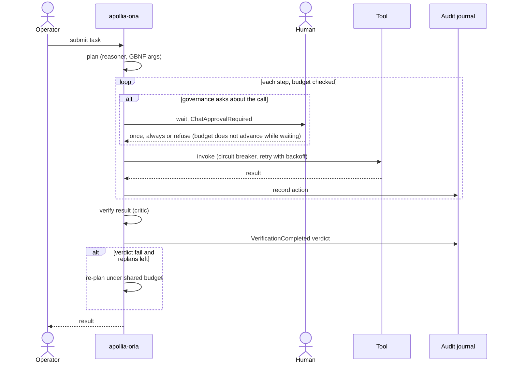
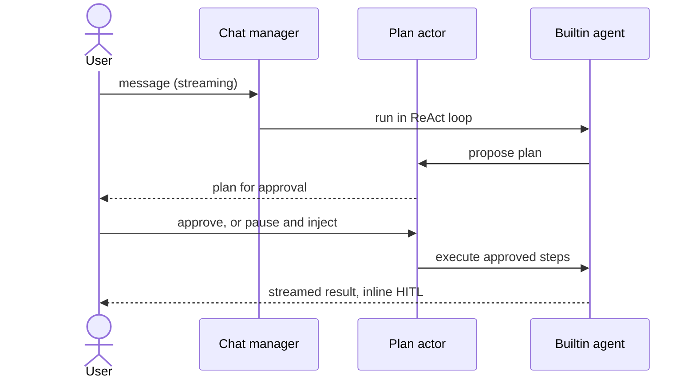
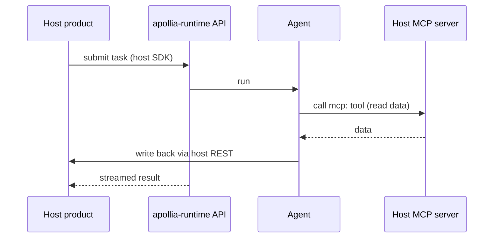
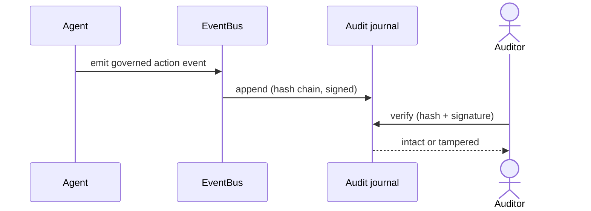
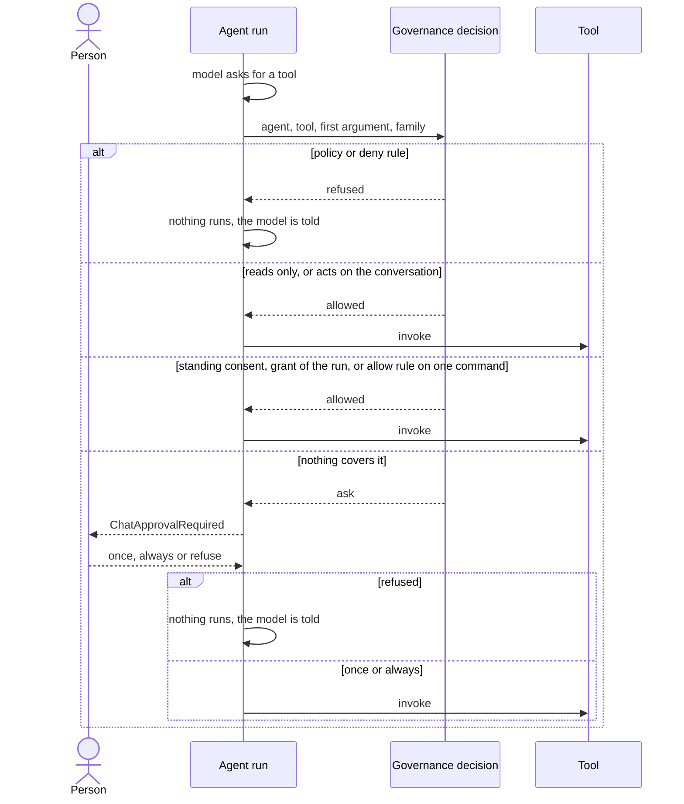
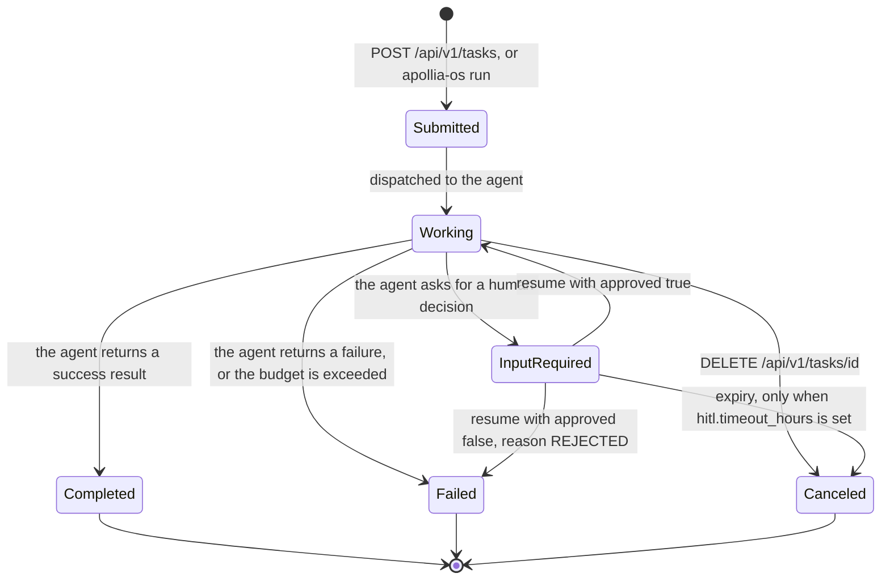
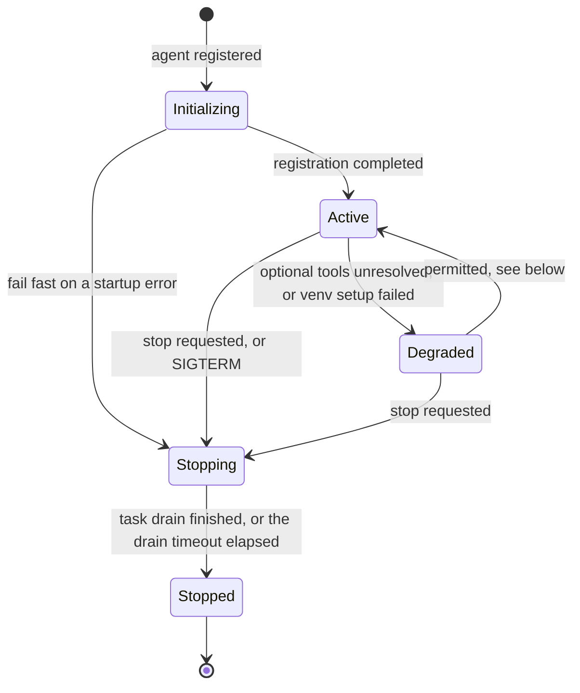
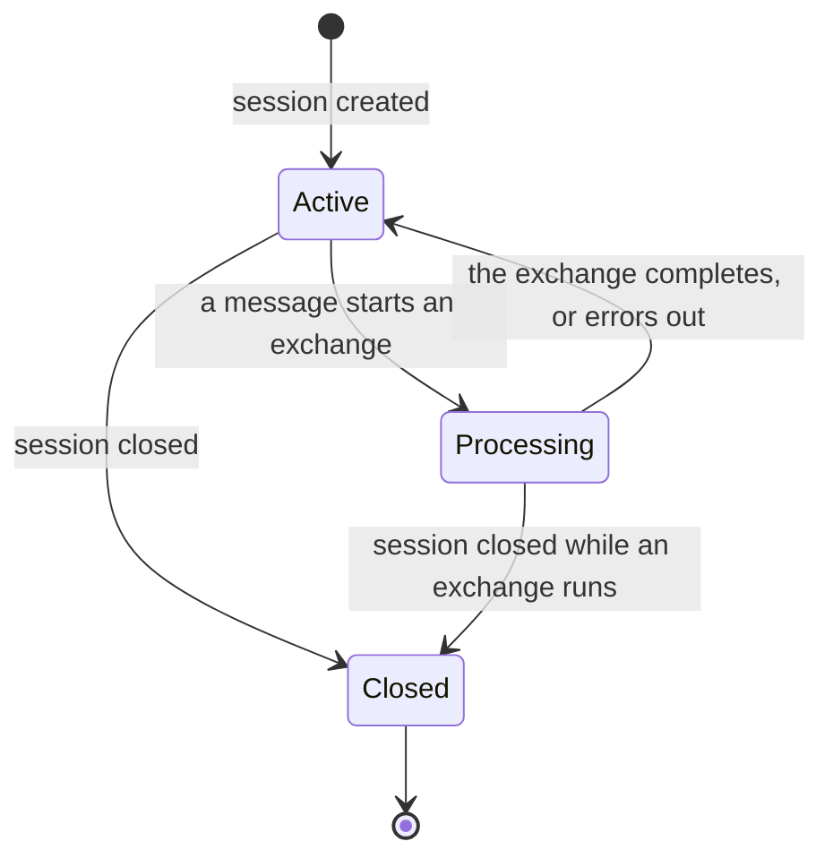
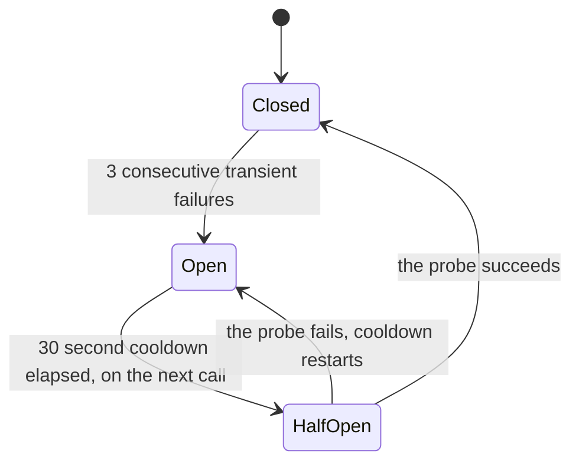

# 6. Runtime view

Five end-to-end scenarios show how the building blocks cooperate at run time.
Each is anchored to a real, wired capability; where a step is only partly wired,
it is called out here and in [Risks and technical debt](/architecture/risks-and-technical-debt).

## Scenario A: an orchestrated task with verification

An operator hands a task to an autonomous agent. The engine plans, executes
governed tool calls under a budget, then a critic verifies the result and can
re-plan on a failing verdict, all within the same ceiling.

The budget increment is wired into the actor loop, so the ceiling actually stops
the agent. The critic runs; no shell check is run on behalf of an agent.
See [the execution model](/architecture/decisions#execution-model)
(verification and critic).

<!-- claim:plan-step-decided-by-governance -->

Read the approval branch precisely. A step of a plan holds no approval of its
own, and an agent declares none: its manifest has no key for it. Each tool call
of a step is decided where it is made, by the same decision as a call of the
chat path. The organisation policy and a deny rule refuse it. A tool that only
reads runs. Anything sensitive runs on a standing consent of the agent for the
family of the tool, and asks otherwise, with the answers once, always and
refuse. A refused call fails its step, and the tool never runs.

The wait is a plain await, so the step budget does not advance while a human
thinks. There is no open position: when governance cannot read what it decides
from, it refuses every sensitive call instead of letting it run.

## Scenario B: chat with plan-mode

A user talks to the runtime in streaming, and for a consequential request the
agent proposes a plan the user approves before execution, with the option to
pause, inject, and resume.

Chat, plan-mode, HITL, fork and children, and pause-inject-resume are wired. One
nuance: sessions left in a processing state are not reloaded at boot, and resume
moves them back to active. See [the plan model](/explanation/the-plan-model).

## Scenario C: host federation over MCP and REST

A host product drives the runtime through the stable API while exposing its own
data over MCP. Apollia reads through the host's MCP tools and writes back through
the host's REST API, so the host stays the system of record.

The MCP client, the governed `mcp:` tool path, and the OpenAPI-plus-SDK driving
contract are wired and proven. See [Embed via federation](/how-to/embed-via-federation)
and [Integrate via the driving contract](/how-to/integrate-via-driving-contract).

## Scenario D: an audited run

Every governed action lands in a signed, hash-chained journal. After the fact,
the run can be verified for integrity.

The signed journal and verification are wired. A captured run can also be
replayed: `apollia-os audit replay <RUN>`, or `POST /api/v1/audit/replay/{run_id}`,
reads the trace of the run from the journal and steps through it offline, each
captured model response followed by the captured outputs of the tool calls it
asked for, then answers identical, diverged (with every divergence) or
incomplete trace. It calls no model and runs no tool: it checks the capture
against itself. It does not run the agent again, because the journal does not
hold the prompt the run started from. Accountability rests on the journal and
its verification. The narrative is
[the accountability model](/explanation/accountability-model).

## Scenario E: how a tool call is governed

This is the path that decides whether a tool runs, for every agent and wherever
the call is made: a conversation, a task, a step of a plan, an item of a batch.
It is one function, `decide`, in `apollia-runtime` (`governance/decision.rs`).
It reads what governance holds (the refusals of the organisation policy, the
fine rules and the standing consents of `governance.db`, and the developer
mode) and answers one call. There is no injection classifier in the decision,
and no set of tool names authorized in advance: the stored rules are matched
against each call.

The decision reads six lines in order, and the first that applies decides.

1. The organisation policy refuses the tool, its connection or its family of
   action: refused.
2. A fine rule `deny` matches the call: refused.
3. The family only reads, or acts on nothing but the conversation or the
   agent's own memory: allowed.
4. The call executes code: allowed by a fine rule `allow` on a single simple
   command, in developer mode only, and asked otherwise.
5. The call proposes a fact for the profile: asked, every time. Any other call
   is allowed by a standing consent of the agent for the family of the tool, or
   by a grant of the run.
6. Anything left is asked, with the answers once, always and refuse.

Five properties follow from that order, and each one is a deliberate choice
rather than an accident.

**A consent covers a family, a rule covers an argument.** Every tool declares a
family of action: reading, reading personal data, writing or deleting, sending
outside the machine, executing code. "Always" on the consent card records a
standing consent of one agent for one family, never for a tool name. A fine
rule is narrower: it names a tool and an optional prefix of its first argument,
it is matched on each call, and it carries one of two scopes, one agent or
every agent. No consent and no rule is scoped to a session or to a project. A
tool nobody classified is asked every time, without "always".

**Refusals come first.** The policy and a `deny` rule are read before anything
that allows, so a standing consent or a grant of the run cannot get around a
standing refusal.

<!-- claim:chat-tool-governance-path -->
**Executing code asks, outside one narrow case.** No standing consent covers a
code executor such as `bash_executor`. In developer mode, a fine rule that
allows a tool under an argument prefix lets through a single simple command,
one that does not chain, pipe, redirect or substitute, and "always" on such a
command is what writes that rule. Everywhere else each execution asks, with
once and refuse as the only answers. This invariant exists because a blanket
allow on a shell is a blanket allow on everything.

**No answer is treated as a refusal.** In a conversation, a prompt that goes
unanswered for five minutes resolves to a refusal, and no tool runs. The
timeout is fixed in the code and is not configurable. A run nobody watches,
such as an item of a batch, does not prompt: the first call that would ask
stops the run, and the decision is listed with the others waiting for the
person (`GET /api/v1/pending-decisions`, answered with
`POST /api/v1/pending-decisions/decide`).

**Governance that cannot read refuses.** When `governance.db` cannot be read,
or a deposited organisation policy is refused, every sensitive call is refused
and reading continues. A failure never becomes a permission.

## State machines

The scenarios above move things between states. The states themselves are
enumerated in the code and, in two cases, the transitions are enforced there
rather than merely intended.

### Task

A task carries one of six statuses, defined by `TaskStatus` in `apollia-core`.

Two details are easy to get backwards.

A rejected approval does not cancel the task, it fails it. The engine returns a
failure carrying the code `REJECTED` and the operator's reason, without calling
the agent again.

A task waiting on a human waits **indefinitely by default**. `[hitl]
timeout_hours` has no default value, so nothing expires a suspended task unless
an operator sets one; `scan_interval_secs` is ignored while it is unset. See the
[configuration reference](/reference/configuration).

Submission is refused outright when the target agent is not in a state to take
work: initializing, stopping and stopped are rejected. A degraded agent still
accepts tasks, and the submission emits a warning.

### Agent process

<!-- claim:process-state-transitions-enforced -->

The agent registry rejects an invalid transition instead of recording it. This is
a real gate, not a convention: `ProcessState::can_transition_to` is consulted on
every state change, and a disallowed one returns an error to the caller.

There is no transition from `Initializing` straight to `Stopped`: a startup
failure goes through `Stopping` like any other stop.

`Degraded` means the agent runs but something optional did not come up. Two
paths reach it, both at registration: optional tools declared and not resolved,
and a Python environment whose package installation failed. `Degraded` to
`Active` is permitted by the transition table, and the runtime never performs it
on its own, so an agent that starts degraded stays degraded until it is
restarted.

The drain timeout defaults to 30 seconds.

### Chat session

`Processing` is what makes a second message on the same session refuse rather
than interleave. Closing a session cancels the exchange in flight. `Closed` is
terminal: the history stays readable, nothing new is accepted.

### Tool circuit breaker

<!-- claim:tool-circuit-breaker-wired -->

Each tool carries its own circuit breaker, keyed by tool name. Repeated
transient failures on one tool stop the calls to that tool and leave the others
alone.

Only failures classified transient count. A permanent error, a bad argument or a
refused permission, leaves the counter untouched: the breaker exists to ride out
a flapping dependency, not to punish a caller. A single success resets the
counter to zero.

The cooldown is not a timer that fires. The breaker moves to `HalfOpen` when the
next call arrives after the cooldown has elapsed, so a tool nobody calls stays
`Open` indefinitely. `HalfOpen` does not restrict concurrency: calls that arrive
together are all admitted, and the first result decides the transition.

Threshold and cooldown are fixed at 3 and 30 seconds. They are not configurable.
