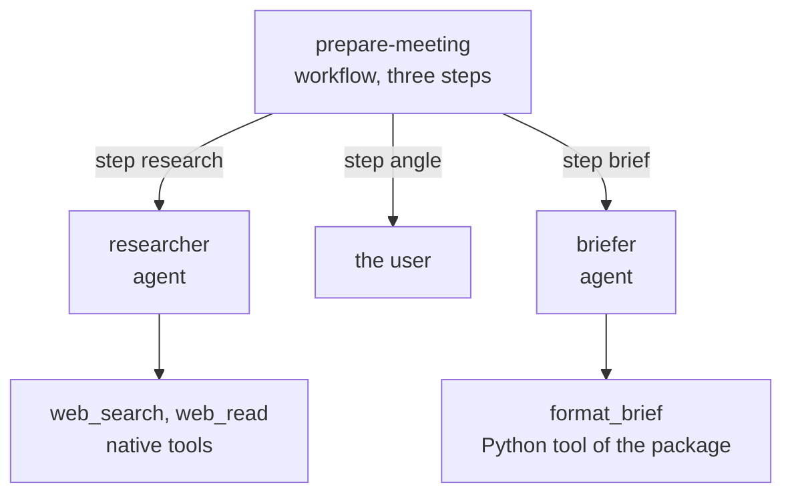
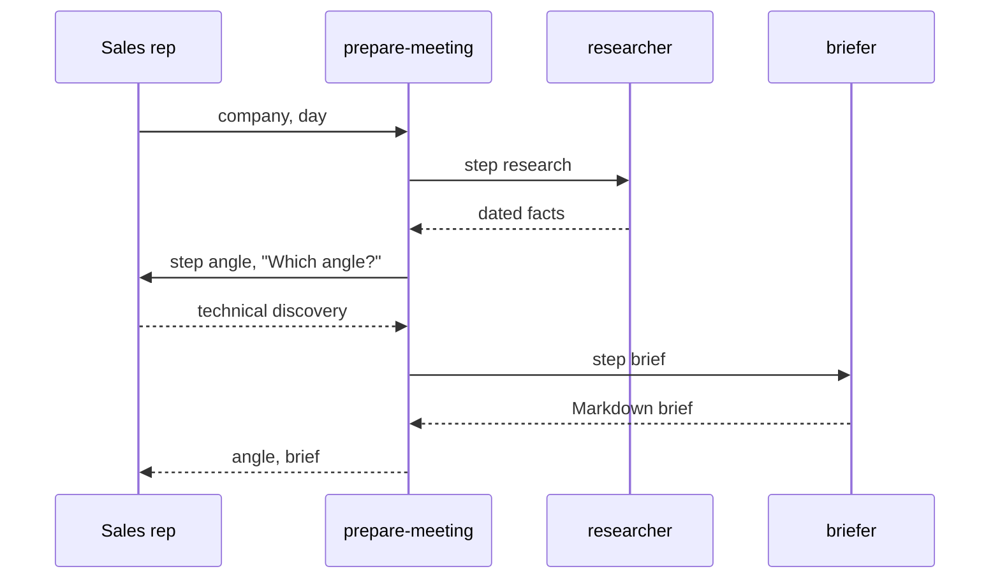

# Build a multi-agent assistant

This advanced tutorial walks through a complete package: a sales meeting-prep
assistant. A sales rep gives a company and a date and, a few minutes later,
gets a Markdown brief to read before the call. Behind that single launch sit
two agents, one Python tool and one workflow that chains them.

You should already have built [your first agent](/tutorials/your-first-agent).
Plan for around forty-five minutes.

## What you will build

The rep launches the workflow with a company and a day:

```sh
apollia-os workflow run meeting-prep/prepare-meeting --input company="Acme Corp" --input day=2026-11-03 --wait
```

The workflow researches the company, asks the rep which angle the meeting
takes, and returns something like:

```markdown
# Meeting with Acme Corp, 2026-11-03

## What we know
- 2026-09-12: opened a second production site in Lyon (acme.example/news)
- 2026-08-30: hired a head of IT (acme.example/team)

## Questions to ask
1. What does the second site change for your planning?
2. Has the new head of IT set a roadmap?
3. Where does the current system slow you down?
```

## Architecture

One package, four items, one responsibility each.



| Item | Kind | Where it is written | What it does |
|---|---|---|---|
| `researcher` | agent | `apollia.toml` | Researches a company on the public web |
| `briefer` | agent | `apollia.toml` | Picks the facts, writes the questions, calls the formatting tool |
| `format_brief` | tool | `tools/brief.py` | Lays the brief out in Markdown |
| `prepare-meeting` | workflow | `flows/prepare.py` | Chains the two agents, with a question to the user between them |

The split follows one rule. What needs judgement is an agent: a mission, and
the tools it may call. What must come out the same way every time is Python: a
tool when an agent decides to call it, a workflow when the order of the steps
is fixed ahead.



The package folder, once finished:

```text
meeting-prep/
  apollia.toml
  tools/brief.py
  flows/prepare.py
  tests/test_prepare.py
```

## Step 1: declare the two agents

Create the folder `meeting-prep` and its `apollia.toml`:

```toml
[package]
name = "meeting-prep"
version = "0.1.0"
publisher = "You"
description = "Prepares a sales meeting: public research on the company, then a brief to read before the call."
sdk = ">=0.3.0"

[[agents]]
id = "researcher"
name = "Researcher"
mission = """
Research a company on the public web. Search, then read the two or three most
relevant pages, primary sources first. Answer with a list of dated facts, one
per line, each followed by the address of the page it comes from. Report only
what the pages say. When you find nothing, say so.
"""
examples = [
    "What happened at Acme Corp in the last three months?",
]

[agents.defaults]
access = ["web_search", "web_read"]
autonomy = "supervised"

[[agents]]
id = "briefer"
name = "Briefer"
mission = """
Turn research notes into a meeting brief. From the notes you are given, pick
the facts that matter for the meeting and write three to five questions to
ask. Then call the tool `format_brief` with the company, the date, the facts
and the questions, and answer with the Markdown it returns, unchanged.
"""

[agents.defaults]
access = ["pkg:meeting-prep/format_brief"]
planning = "never"
```

Each agent is granted only what its mission needs. `researcher` reaches two
native tools of the runtime, named as they are; `briefer` reaches one tool of
this package, named `pkg:<package>/<tool>`. Neither can call what the other
holds.

Two defaults appear here beside `access`. `autonomy` is the tier the agent
runs at: from `supervised` upward the runtime checks the result of a run
before accepting it, which is worth its cost for research. `planning` says
whether the agent writes a plan before acting (`never`, `auto` or `always`);
`briefer` has one tool to call and needs none. Both are recommendations the
person can override, like every default. See
[Autonomy tiers](/explanation/autonomy-tiers).

## Step 2: write the formatting tool

The brief must have the same layout every time, so the layout is code and not
a request to a model. Create `meeting-prep/tools/brief.py`:

```python
"""The formatting tool of the package meeting-prep."""

from typing import Annotated

from apollia import DomainError, tool
from apollia.types import Ctx


@tool(
    "format_brief",
    "Lay a meeting brief out in Markdown, from its facts and its questions.",
    action="read",
    examples=[
        {
            "company": "Acme Corp",
            "date": "2026-11-03",
            "facts": ["2026-09-12: opened a second site in Lyon (acme.example/news)"],
            "questions": ["What does the second site change for your planning?"],
        }
    ],
)
async def format_brief(
    ctx: Ctx,
    company: Annotated[str, "The company the meeting is with."],
    date: Annotated[str, "The day of the meeting, as YYYY-MM-DD."],
    facts: Annotated[list[str], "The facts to keep, one per item."],
    questions: Annotated[list[str], "The questions to ask, one per item."],
) -> dict[str, str]:
    if not facts:
        raise DomainError("NO_FACTS", "a brief needs at least one fact")
    ctx.logger.info("format_brief: %d facts, %d questions", len(facts), len(questions))
    lines = [f"# Meeting with {company}, {date}", "", "## What we know"]
    lines += [f"- {fact}" for fact in facts]
    lines += ["", "## Questions to ask"]
    lines += [f"{n}. {question}" for n, question in enumerate(questions, 1)]
    return {"markdown": "\n".join(lines)}
```

`DomainError` is how a tool refuses: a stable code the caller can branch on,
and a message. The agent that called the tool reads the refusal.

<!-- claim:secrets-gated-by-manifest-declaration -->

This tool needs no credential, and a package never ships one. A tool that
reads `ctx.secrets.get("SOME_KEY")` gets `None` for any key its context was
not granted, even when a value sits in the store under that name, so it must
handle `None`. An account the package depends on (a mailbox, a CRM) is
declared as a required connection, under `[[requires]]` in `apollia.toml`: the
install preview shows whether it is present or missing.

## Step 3: write the workflow

A workflow is an `async` function under `@workflow` that receives `(ctx,
inputs)`. Its steps are declared ahead, in the decorator, and that list is
what the card of the workflow shows without running the code. Create
`meeting-prep/flows/prepare.py`:

```python
"""The workflow of the package meeting-prep."""

import datetime
from typing import Annotated, NotRequired, TypedDict

from apollia import LongText, WorkflowCtx, workflow
from apollia.errors import QuestionDeclined

# No `from __future__ import annotations` in this module: it would turn the
# annotations of the TypedDict into strings, and the input schema is read
# from them.

ANGLES = ["commercial follow-up", "technical discovery"]


class PrepareMeeting(TypedDict):
    """Inputs of the prepare-meeting workflow."""

    company: Annotated[str, "The company the meeting is with."]
    day: Annotated[datetime.date, "The day of the meeting."]
    context: NotRequired[Annotated[LongText, "What you already know, if anything."]]


@workflow(
    "prepare-meeting",
    "Research a company, then write the brief to read before the meeting.",
    inputs=PrepareMeeting,
    steps=["research", "angle", "brief"],
    action="read",
)
async def prepare_meeting(ctx: WorkflowCtx, inputs: PrepareMeeting) -> dict[str, str]:
    company = inputs["company"]

    async with ctx.step("research"):
        findings = await ctx.agents.run(
            "researcher",
            f"What happened at {company} in the last three months?",
        )

    async with ctx.step("angle"):
        try:
            angle = await ctx.user.ask(
                f"Which angle for the meeting with {company}?",
                options=ANGLES,
            )
        except QuestionDeclined:
            angle = ANGLES[0]

    async with ctx.step("brief"):
        brief = await ctx.agents.run(
            "briefer",
            f"Company: {company}\n"
            f"Date: {inputs['day'].isoformat()}\n"
            f"Angle: {angle}\n"
            f"Known context: {inputs.get('context', 'none')}\n"
            f"Research notes:\n{findings}",
        )

    return {"angle": angle, "brief": brief}
```

<!-- claim:skill-schema-built-from-typeddict-required-keys -->

The inputs are a `TypedDict`, and the launch form is built from it: a required
text for `company`, a date for `day`, an optional long text for
`context`. Which fields are required is read from the `TypedDict` itself when
the module is imported, which is why `from __future__ import annotations` is
banned from a module that defines one: stringified annotations produce a wrong
schema, not an error.

The body opens each step with `async with ctx.step("name")`. A name the
decorator did not declare is refused, so the body cannot drift from the card.
Inside a step, three services exist only in a workflow run:

- **`ctx.agents.run(agent_id, message)`** hands a message to an agent, as the
  first turn of a fresh conversation, and returns its final answer. The agent
  runs under its own grants and spends from the budget of the run.
- **`ctx.user.ask(question, options=...)`** stops the run inside the step until
  the person answers. A refusal raises `QuestionDeclined`; caught, the workflow
  goes on, here with the first angle.
- **`ctx.workflows.run(workflow_id, inputs)`** runs another workflow as a step.
  This package does not need it.

`action="read"` is the family of the most sensitive thing the workflow does.
Here both agents only read.

## Step 4: test the workflow

A workflow is a plain function too. `MockContext` scripts the answer of each
agent and of the user, and records every call. Create
`meeting-prep/tests/test_prepare.py`:

```python
import asyncio
import datetime

from apollia.testing import MockContext

from flows.prepare import prepare_meeting

QUESTION = "Which angle for the meeting with Acme Corp?"


def test_prepare_meeting_hands_the_research_to_the_briefer():
    # GIVEN two agents with scripted answers and a user who picks an angle
    ctx = MockContext()
    ctx.agents.answers = {
        "researcher": "2026-09-12: opened a second site in Lyon (acme.example/news)",
        "briefer": "# Meeting with Acme Corp, 2026-11-03",
    }
    ctx.user.answers = {QUESTION: "technical discovery"}

    # WHEN the workflow is awaited as written
    result = asyncio.run(
        prepare_meeting(ctx, {"company": "Acme Corp", "day": datetime.date(2026, 11, 3)})
    )

    # THEN the briefer received the research and the chosen angle
    assert [agent for agent, _ in ctx.agents.run_calls] == ["researcher", "briefer"]
    message = ctx.agents.run_calls[1][1]
    assert "opened a second site in Lyon" in message
    assert "Angle: technical discovery" in message
    assert result == {
        "angle": "technical discovery",
        "brief": "# Meeting with Acme Corp, 2026-11-03",
    }


def test_prepare_meeting_keeps_the_first_angle_when_the_question_is_declined():
    # GIVEN a user who declines the question
    ctx = MockContext()
    ctx.user.declined = {QUESTION: None}

    # WHEN the workflow is awaited
    result = asyncio.run(
        prepare_meeting(ctx, {"company": "Acme Corp", "day": datetime.date(2026, 11, 3)})
    )

    # THEN the run goes on with the first angle
    assert result["angle"] == "commercial follow-up"
```

```sh
cd meeting-prep
python -m pytest -p no:cacheprovider tests
cd ..
```

The test proves the order of the steps and what travels between them. It says
nothing about what a model answers: under `MockContext` no agent runs.

## Step 5: describe, build and install

```sh
python -m apollia describe meeting-prep
apollia-os package build meeting-prep
apollia-os package inspect meeting-prep-0.1.0.apo
```

`describe` writes one `[[tools]]` entry and one `[[workflows]]` entry into
`apollia.toml`, the second with its steps and its input schema. `inspect`
reports two agents, one workflow and one tool.

With the runtime started and a model configured, as in the first tutorial:

```sh
apollia-os package preview meeting-prep-0.1.0.apo
apollia-os package install meeting-prep-0.1.0.apo
```

`preview` lists, for each agent, the accesses it asks for and what each one
permits. Then read the workflow as the runtime sees it:

```sh
apollia-os workflow show meeting-prep/prepare-meeting
```

`workflow show` prints the steps and each input with its type, read from the
manifest.

## Step 6: run it

Launch the workflow and follow it to its end:

```sh
apollia-os workflow run meeting-prep/prepare-meeting --input company="Acme Corp" --input day=2026-11-03 --wait
```

The run stops in its second step, on the question. Answer it from a second
terminal, with the identifier `pending` prints:

```sh
apollia-os approvals pending
apollia-os approvals decide <ID> answer --value "technical discovery"
```

The run goes on, and `--wait` ends on the result. In the desktop app, the same
workflow has a launch form built from its inputs.

Each agent also works on its own. Nothing ties `researcher` to the workflow:

```sh
apollia-os run researcher "What happened at Acme Corp in the last three months?"
```

## What you built

A package where each item does one thing. Two agents hold the judgement, each
with a mission and only the tools it needs. A tool holds the layout. A workflow
holds the order: research, a question to the person, the brief. All four are
installed, previewed, updated and removed together, as one archive.

## Next steps

- Add a third agent that reads the history of the account from a source the
  person connected, and a step that calls it between `research` and `angle`.
- Split the workflow: move the research into a workflow of its own and call it
  with `ctx.workflows.run`, up to three levels deep.
- Read what every `ctx` service guarantees in the
  [SDK / ctx reference](/reference/sdk).
