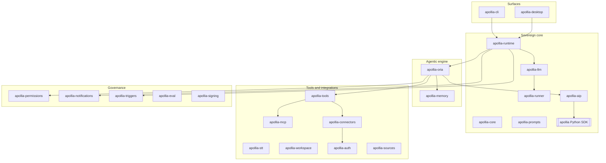

# 5. Vue de construction

Il s'agit de la vue C4 conteneurs et composants. Apollia est un workspace Rust
plus un SDK Python, ses crates regroupés en cinq domaines. Chaque crate
ci-dessous porte un rôle en une ligne qui correspond à ce que le code fait
réellement. Pour les formes exactes de l'API, de la CLI et du SDK, cette page
renvoie vers la référence générée plutôt que de la reformuler.

## Conteneurs par domaine

Les flèches indiquent les principales directions d'appel, pas la totalité des
liens. La décision de gouvernance et le journal d'audit, tous deux à
l'intérieur d'`apollia-runtime`, se trouvent sur le chemin de chaque appel
d'outil d'un agent ; la décision lit les règles, les accords et la politique
de l'organisation que stocke `apollia-permissions`. La
[vue d'exécution](/architecture/runtime-view) rend cela concret.

## Socle souverain

| Crate | Rôle |
|---|---|
| **apollia-runtime** | Le démon. Héberge le superviseur d'acteurs Tokio, l'EventBus, l'API HTTP axum, la gestion du chat et des plans, ainsi que le journal d'audit signé avec vérification. |
| **apollia-runner** | Le sidecar de reconnaissance vocale : `whisper` (via `whisper-rs`) hors processus, un backend GPU par build. L'inférence LLM locale ne s'exécute plus ici : elle passe par le `llama-server` embarqué (upstream llama.cpp) que le démon supervise, via une API HTTP compatible OpenAI avec appel d'outils natif `--jinja` et traitement par lots en continu. |
| **apollia-llm** | Le routeur LLM : le moteur local et les backends distants atteints par un seul client compatible OpenAI (un serveur auto-hébergé, une passerelle, Ollama), suivi quotidien des coûts, le client d'embeddings du moteur local, les fiches de modèles et l'index de leur registre, un registre GGUF Hugging Face, la détection matérielle, et le moteur de recommandation qui classe les fichiers GGUF pour la machine locale à partir de leur en-tête, de leur coût mémoire et d'une table de générations tenue à la main. |
| **apollia-core** | Types partagés : le modèle de plan unifié, la configuration, les hooks de cycle de vie, et la configuration de routage hybride qui permet à une exécution d'escalader vers un modèle de pointe sur une clé utilisateur. |
| **apollia-aip** | Le pont PyO3 : il importe les outils et les workflows Python des paquets installés, les exécute dans le processus, et construit le `ctx` que chacun reçoit. |
| **apollia-prompts** | Le corpus de prompts anglais avec un pied de page de langue, partagé dans tout le moteur. |
| **apollia (SDK Python)** | AgentKit : les deux décorateurs avec lesquels s'écrit le Python d'un paquet (`@tool` et `@workflow`), les schémas `TypedDict`, la commande `describe` qui écrit les descripteurs d'outils et de workflows d'un paquet dans son `apollia.toml`, et les doublures de test (`MockContext`). Il ne déclare aucun agent : un agent est une donnée dans `apollia.toml`. Le contexte d'exécution est le `ctx` à dix-sept services. |

Le contrat `ctx` est `sdk/apollia/types.py` et est documenté service par
service dans la [référence SDK](/reference/sdk). Les dix-sept services sont
`llm`, `memory`, `tools`, `agents`, `workflows`, `user`, `mail`, `datasources`,
`templates`, `secrets`, `events`, `logger`, `profile`, `workspace`, `stt`,
`notify`, et `budget`. Trois d'entre eux, `agents`, `workflows` et `user`, ne
sont liés que pendant l'exécution d'un workflow.

## Moteur agentique

| Crate | Rôle |
|---|---|
| **apollia-oria** | Le moteur autonome. Il exécute une boucle ReAct selon deux modes, direct et orchestré, avec un observateur qui classifie et un raisonneur qui planifie et re-planifie. Il porte le budget d'étapes non contournable, la résilience des outils, la passe de vérification et de critique, la compaction de contexte à trois niveaux, et la parallélisation des outils en lecture seule sur un graphe de dépendances. Le déversement sur disque des résultats volumineux d'outils est implémenté mais n'est installé sur aucun chemin d'exécution : la compaction reste donc uniquement en mémoire. |
| **apollia-memory** | Trois couches de mémoire (épisodique, sémantique, procédurale) au-dessus de SQLite FTS5 avec classement BM25, un traqueur d'injection, une purge TTL, un magasin des choix de plan, et un export/import souverain. Un agent atteint son propre espace, nommé d'après lui et gardé d'une conversation et d'une tâche à l'autre, avec les outils `memory_search` et `memory_write` : rien n'est injecté dans son prompt et rien n'est écrit à sa place. |

## Outils et intégrations

| Crate | Rôle |
|---|---|
| **apollia-tools** | La bibliothèque d'outils natifs (shell, Python, opérations sur fichiers, notebook, récupération HTTP, recherche et lecture web, recherche et écriture en mémoire, proposition d'un fait pour le profil, demande à l'utilisateur), la famille d'action que chaque outil déclare, le schéma du manifeste d'un paquet, avec un bac à sable de chemins, une garde SSRF, un audit SHA-256 de chaque appel, et un filtre de commandes shell dont les listes de motifs sont livrées vides et qu'aucun code de production ne remplit, si bien qu'il ne bloque aucune commande. |
| **apollia-mcp** | Le client MCP (initialize plus tools/list via stdio, Streamable HTTP, et SSE, avec une découverte mDNS optionnelle). Les agents invoquent les outils MCP via le chemin d'outil gouverné. Le côté serveur est un pont stdio vers le daemon en cours d'exécution, qui sert les agents et les workflows que l'utilisateur a marqués comme exposés, et il est désactivé par défaut. |
| **apollia-connectors** | Des connecteurs natifs Google et Microsoft agissant sur le mail, le calendrier et les fichiers. Google est limité aux scopes non restreints du niveau gratuit ; Microsoft est plus large. Les jetons vont dans le trousseau ou dans un fichier chiffré age. |
| **apollia-stt** | Reconnaissance vocale locale sur `whisper` : transcription et traduction par lots, plus une chaîne de traitement audio. Uniquement par lots, sans diffusion en continu. |
| **apollia-workspace** | Le contexte projet (Git, un fournisseur de règles `APOLLIA.md`, une arborescence de fichiers, un fournisseur de scripts) et des commandes slash personnalisées : la couche harnais autour d'un agent. |
| **apollia-auth** | Les flux OAuth et PKCE qui alimentent les connecteurs, avec les secrets qui atterrissent dans le trousseau ou dans un fichier age. |
| **apollia-sources** | Les sources qu'un agent peut consulter une fois cochées pour lui : dossiers indexés, fichiers, boîtes mail, profil et mémoire. Porte l'acteur qui possède leur registre, une table de `system.db` ; la liste `sources` d'un agent en nomme les identifiants, ou `profile` et `memory`. |

Pour la liste complète des outils natifs, voir le [catalogue des outils
natifs](/reference/native-tools).

## Gouvernance

| Crate | Rôle |
|---|---|
| **apollia-permissions** | Ce à partir de quoi la gouvernance décide : les règles fines (un outil et un préfixe d'argument optionnel, à la portée d'un agent ou de tous les agents), les accords permanents qu'un agent détient par famille d'action, la politique de l'organisation et sa vérification, et le garde-fou qui ne laisse une règle s'appliquer à un exécuteur de code que sur une commande simple et unique. La décision elle-même est prise dans `apollia-runtime` (voir [concepts transversaux](./07-crosscutting-concepts.md)) ; les paliers d'autonomie sont définis dans `apollia-core`. |
| **apollia-notifications** | Notifications opérateur sur desktop, terminal et webhook, avec niveaux de gravité, HITL, et un observateur d'inactivité. |
| **apollia-triggers** | Démarrages d'agent planifiés et réactifs : sources cron, intervalle, ponctuelle et surveillance de fichiers, et déclencheurs webhook, que le runtime reçoit sur `POST /webhooks/:id` et accepte sous une signature HMAC-SHA256. |
| **apollia-eval** | Évaluation souveraine : suites TOML déclaratives et métriques de succès, de longueur, de durée réelle, et de coût. Une assertion `llm_judge` existe dans le schéma de suite, mais aucun juge n'est installé par la CLI, si bien qu'une telle assertion échoue au lieu d'être notée. |
| **apollia-signing** | Signatures hors ligne : Ed25519 sur une liste d'empreintes pour les paquets d'agents et les politiques d'organisation, et la vérification des signatures minisign que la chaîne de publication appose sur les métadonnées de distribution. |

Le journal d'audit et la vérification qui soutiennent la redevabilité
résident dans `apollia-runtime`. Voir [le modèle de
redevabilité](/explanation/accountability-model) pour comprendre comment ils
s'articulent, et [Auditer et vérifier une exécution](/how-to/audit-and-verify)
pour les commandes.

## Surfaces

| Crate | Rôle |
|---|---|
| **apollia-cli** | La CLI native IA : `do` (langage naturel vers une commande validée sur l'arbre de commandes réel, dry-run et confirmation, redispatché à travers la gouvernance), `explain` (lecture seule), `suggest` (déterministe, sans LLM), une palette floue, et un `guide` écrit. |
| **apollia-desktop** | L'application opérateur en Tauri v2 et Svelte 5. Des centaines de commandes Tauri réparties sur des dizaines de modules donnent une vue opérateur sur le chat, MCP, les connecteurs, les tâches, la mémoire, la gouvernance, les notifications, et l'audit, en atteignant le backend via une référence directe ou un pont REST local. |

La surface de commandes est la [référence CLI](/reference/cli) ; la surface
HTTP que pilotent le desktop et les hôtes est la [référence de l'API
HTTP](/reference/api/apollia-os-runtime-api).
