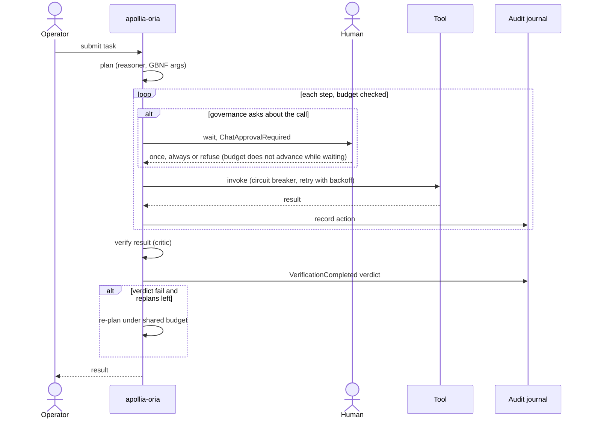
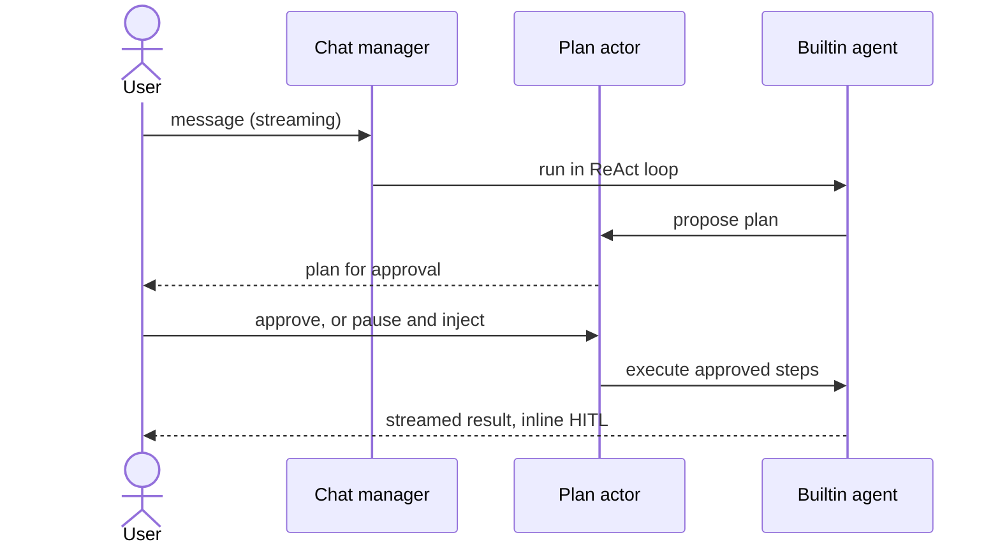
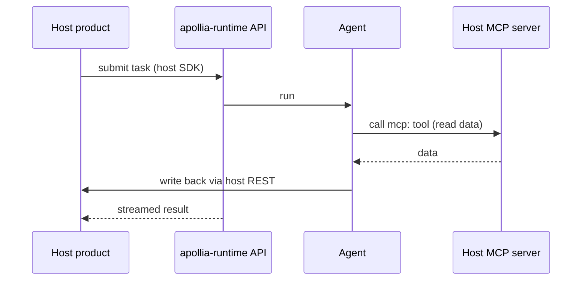
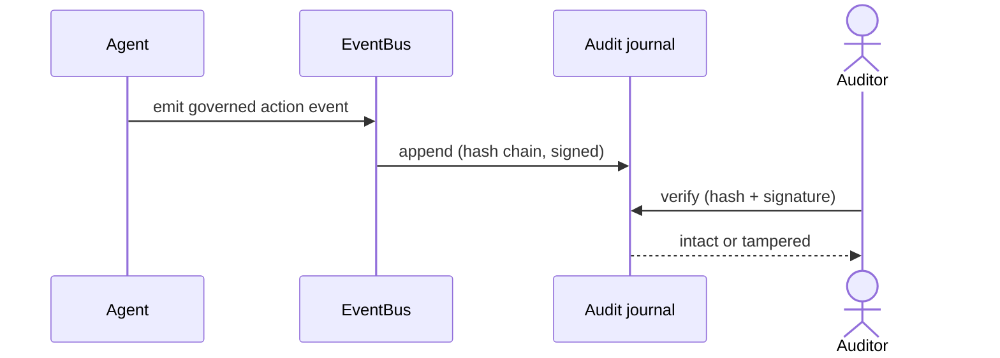
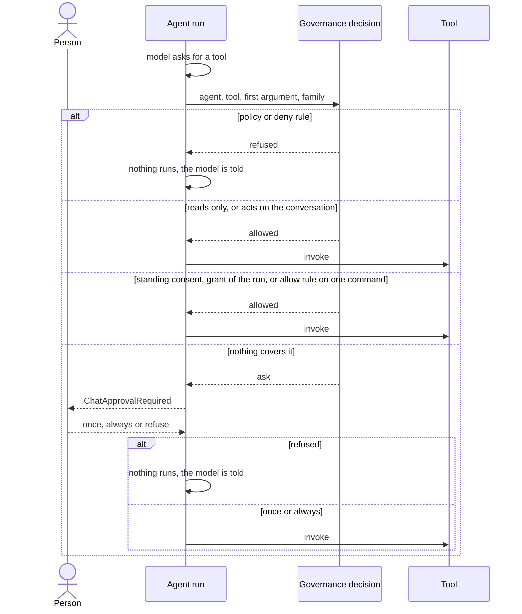
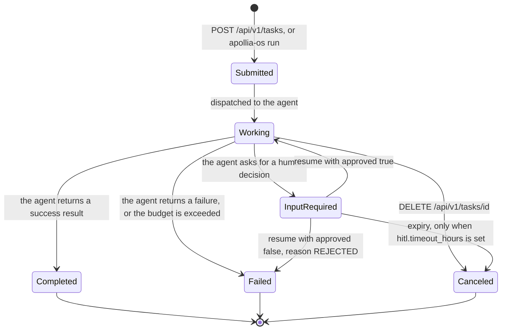
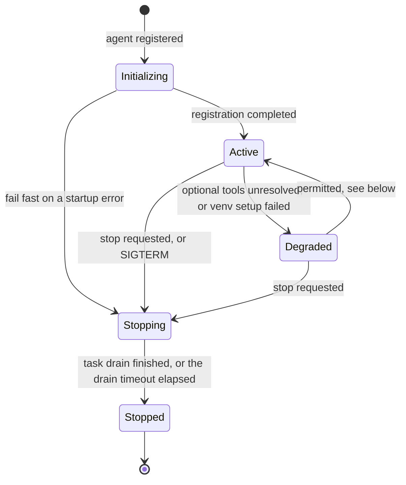
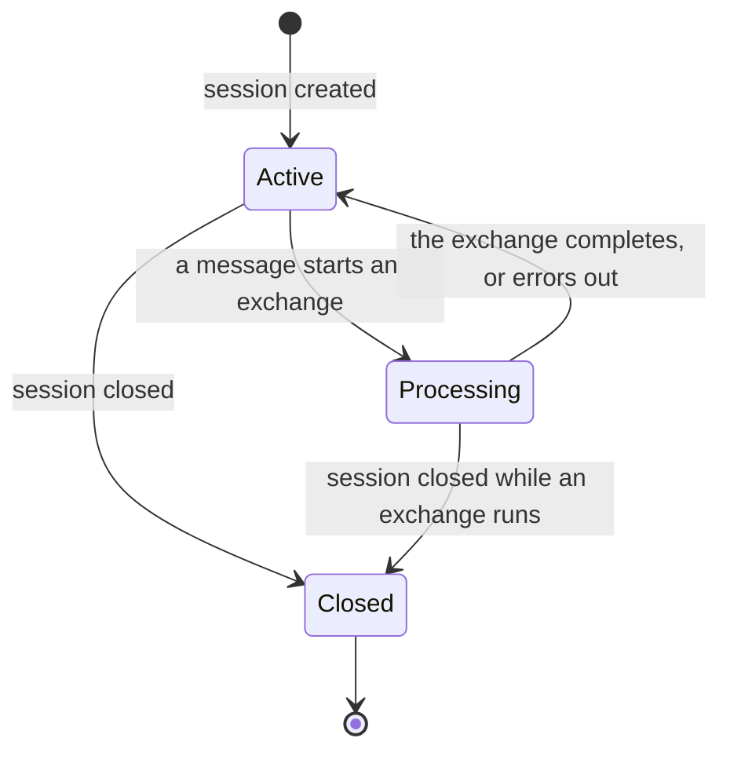
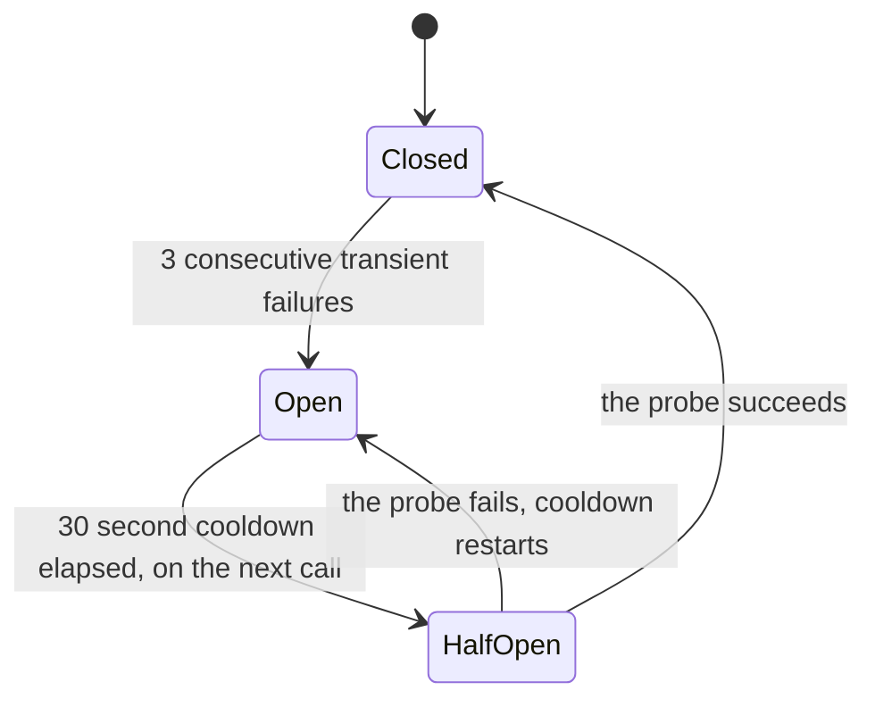

# 6. Vue d'exécution

Cinq scénarios de bout en bout montrent comment les blocs de construction
coopèrent à l'exécution. Chacun s'appuie sur une capacité réelle et effectivement
câblée ; lorsqu'une étape n'est que partiellement câblée, cela est signalé ici et
dans [Risques et dette technique](/architecture/risks-and-technical-debt).

## Scénario A : une tâche orchestrée avec vérification

Un opérateur confie une tâche à un agent autonome. Le moteur planifie, exécute
des appels d'outils gouvernés sous un budget, puis un critique vérifie le
résultat et peut replanifier en cas de verdict d'échec, le tout sous le même
plafond.

L'incrément de budget est câblé dans la boucle de l'acteur, si bien que le
plafond arrête réellement l'agent. Le critique s'exécute ; aucune vérification
shell n'est exécutée pour le compte d'un agent.
Voir [le modèle d'exécution](/architecture/decisions#execution-model)
(vérification et critique).

<!-- claim:plan-step-decided-by-governance -->

Lisez la branche d'approbation avec précision. Une étape d'un plan ne porte
aucune approbation qui lui soit propre, et un agent n'en déclare aucune : son
manifeste n'a pas de clé pour cela. Chaque appel d'outil d'une étape est décidé
là où il est fait, par la même décision qu'un appel du chemin du chat. La
politique de l'organisation et une règle de refus le refusent. Un outil qui ne
fait que lire s'exécute. Tout ce qui est sensible s'exécute sur un consentement
permanent de l'agent pour la famille de l'outil, et demande sinon, avec les
réponses une fois, toujours et refuser. Un appel refusé fait échouer son étape,
et l'outil ne s'exécute jamais.

L'attente est un simple await, si bien que le budget d'étape n'avance pas
pendant qu'un humain réfléchit. Il n'y a pas de position ouverte : quand la
gouvernance ne peut pas lire ce dont elle décide, elle refuse tout appel
sensible au lieu de le laisser s'exécuter.

## Scénario B : chat avec plan-mode

Un utilisateur parle au runtime en streaming, et pour une requête à conséquence
l'agent propose un plan que l'utilisateur approuve avant l'exécution, avec la
possibilité de mettre en pause, d'injecter, et de reprendre.

Le chat, le plan-mode, le HITL, le fork et les enfants, et le
pause-inject-resume sont câblés. Une nuance : les sessions laissées dans un
état de traitement ne sont pas rechargées au démarrage, et la reprise les
ramène à l'état actif. Voir [le modèle de plan](/explanation/the-plan-model).

## Scénario C : fédération d'hôte via MCP et REST

Un produit hôte pilote le runtime via l'API stable tout en exposant ses propres
données sur MCP. Apollia lit à travers les outils MCP de l'hôte et écrit en
retour via l'API REST de l'hôte, de sorte que l'hôte reste le système de
référence.

Le client MCP, le chemin d'outil `mcp:` gouverné, et le contrat pilote
OpenAPI-plus-SDK sont câblés et éprouvés. Voir
[Intégrer par fédération](/how-to/embed-via-federation) et
[Intégrer via le contrat pilote](/how-to/integrate-via-driving-contract).

## Scénario D : une exécution auditée

Chaque action gouvernée atterrit dans un journal signé et chaîné par hachage.
Après coup, l'exécution peut être vérifiée pour son intégrité.

Le journal signé et la vérification sont câblés. Une exécution capturée peut
aussi être rejouée : `apollia-os audit replay <RUN>`, ou
`POST /api/v1/audit/replay/{run_id}`, lit la trace de l'exécution dans le journal
et la parcourt hors ligne, chaque réponse de modèle capturée suivie des sorties
capturées des appels d'outils qu'elle demandait, puis répond identique,
divergente (avec chaque divergence) ou trace incomplète. Le rejeu n'appelle
aucun modèle et n'exécute aucun outil : il confronte la capture à elle-même. Il
ne relance pas l'agent, parce que le journal ne conserve pas le prompt dont
l'exécution est partie. La redevabilité repose sur le journal et sa
vérification. Le récit correspondant est
[le modèle de responsabilité](/explanation/accountability-model).

## Scénario E : comment un appel d'outil est gouverné

C'est le chemin qui décide si un outil s'exécute, pour chaque agent et où que
l'appel soit fait : une conversation, une tâche, une étape de plan, un élément
de lot. C'est une seule fonction, `decide`, dans `apollia-runtime`
(`governance/decision.rs`). Elle lit ce que la gouvernance détient (les refus de
la politique de l'organisation, les règles fines et les accords permanents de
`governance.db`, et le mode développeur) et répond à un appel. Il n'y a pas de
classificateur d'injection dans la décision, ni d'ensemble de noms d'outils
autorisés d'avance : les règles stockées sont confrontées à chaque appel.

La décision lit six lignes dans l'ordre, et la première qui s'applique décide.

1. La politique de l'organisation refuse l'outil, sa connexion ou sa famille
   d'action : refusé.
2. Une règle fine `deny` correspond à l'appel : refusé.
3. La famille ne fait que lire, ou n'agit que sur la conversation ou sur la
   mémoire propre de l'agent : autorisé.
4. L'appel exécute du code : autorisé par une règle fine `allow` sur une
   commande simple et unique, en mode développeur seulement, et demandé sinon.
5. L'appel propose un fait pour le profil : demandé, à chaque fois. Tout autre
   appel est autorisé par un accord permanent de l'agent pour la famille de
   l'outil, ou par un accord donné pour l'exécution.
6. Tout ce qui reste est demandé, avec les réponses une fois, toujours et
   refuser.

Cinq propriétés découlent de cet ordre, et chacune est un choix délibéré
plutôt qu'un accident.

**Un accord couvre une famille, une règle couvre un argument.** Chaque outil
déclare une famille d'action : lire, lire des données personnelles, écrire ou
supprimer, envoyer hors de la machine, exécuter du code. « Toujours » sur la
carte d'accord enregistre un accord permanent d'un agent pour une famille,
jamais pour un nom d'outil. Une règle fine est plus étroite : elle nomme un
outil et un préfixe optionnel de son premier argument, elle est confrontée à
chaque appel, et elle porte l'une de deux portées, un agent ou tous les
agents. Aucun accord et aucune règle n'a pour portée une session ou un projet.
Un outil que personne n'a classé est demandé à chaque fois, sans « toujours ».

**Les refus passent en premier.** La politique et une règle `deny` sont lues
avant tout ce qui autorise, si bien qu'un accord permanent ou un accord donné
pour l'exécution ne peut pas contourner un refus permanent.

<!-- claim:chat-tool-governance-path -->
**Exécuter du code demande, hors d'un cas étroit.** Aucun accord permanent ne
couvre un exécuteur de code comme `bash_executor`. En mode développeur, une
règle fine qui autorise un outil sous un préfixe d'argument laisse passer une
commande simple et unique, qui n'enchaîne pas, ne redirige pas, n'utilise ni
tube ni substitution, et « toujours » sur une telle commande est ce qui écrit
cette règle. Partout ailleurs chaque exécution demande, avec une fois et
refuser pour seules réponses. Cet invariant existe parce qu'une autorisation
globale sur un shell est une autorisation globale sur tout.

**L'absence de réponse est traitée comme un refus.** Dans une conversation,
une demande restée sans réponse pendant cinq minutes se résout en refus, et
aucun outil ne s'exécute. Le délai est fixé dans le code et n'est pas
configurable. Une exécution que personne ne regarde, comme un élément de lot,
ne demande pas : le premier appel qui demanderait arrête l'exécution, et la
décision est listée avec celles qui attendent la personne
(`GET /api/v1/pending-decisions`, répondue par
`POST /api/v1/pending-decisions/decide`).

**Une gouvernance qui ne peut pas lire refuse.** Quand `governance.db` ne peut
pas être lu, ou qu'une politique d'organisation déposée est refusée, chaque
appel sensible est refusé et la lecture continue. Une défaillance ne devient
jamais une permission.

## Machines à états

Les scénarios ci-dessus font transiter des éléments entre des états.
Les états eux-mêmes sont énumérés dans le code et, dans deux cas, les
transitions y sont imposées plutôt que simplement voulues.

### Tâche

Une tâche porte l'un de six statuts, définis par `TaskStatus` dans
`apollia-core`.

Deux détails sont faciles à inverser.

Une approbation refusée n'annule pas la tâche, elle la fait échouer. Le
moteur renvoie un échec portant le code `REJECTED` et le motif de
l'opérateur, sans rappeler l'agent.

Une tâche qui attend un humain attend **indéfiniment par défaut**.
`[hitl] timeout_hours` n'a pas de valeur par défaut, si bien que rien ne fait
expirer une tâche suspendue à moins qu'un opérateur n'en fixe une ;
`scan_interval_secs` est ignoré tant qu'il n'est pas défini. Voir la
[référence de configuration](/reference/configuration).

La soumission est refusée d'emblée lorsque l'agent cible n'est pas dans un
état à même de prendre du travail : initializing, stopping et stopped sont
rejetés. Un agent degraded accepte quand même des tâches, et la soumission
émet un avertissement.

### Processus d'agent

<!-- claim:process-state-transitions-enforced -->

Le registre d'agents rejette une transition invalide au lieu de
l'enregistrer. C'est une véritable barrière, pas une convention :
`ProcessState::can_transition_to` est consulté à chaque changement d'état, et
une transition non autorisée renvoie une erreur à l'appelant.

Il n'existe pas de transition directe de `Initializing` à `Stopped` : un
échec au démarrage passe par `Stopping` comme tout autre arrêt.

`Degraded` signifie que l'agent tourne mais qu'un élément optionnel n'a pas
démarré. Deux chemins y mènent, tous deux à l'enregistrement : des outils
optionnels déclarés et non résolus, et un environnement Python dont
l'installation des paquets a échoué. La transition de `Degraded` vers
`Active` est autorisée par la table de transitions, mais le runtime ne
l'effectue jamais de lui-même, si bien qu'un agent qui démarre en `Degraded`
y reste jusqu'à son redémarrage.

Le délai de vidage est de 30 secondes par défaut.

### Session de chat

`Processing` est ce qui fait qu'un second message sur la même session est
refusé plutôt qu'entrelacé. Fermer une session annule l'échange en cours.
`Closed` est terminal : l'historique reste lisible, rien de nouveau n'est
accepté.

### Circuit breaker d'outil

<!-- claim:tool-circuit-breaker-wired -->

Chaque outil porte son propre circuit breaker, indexé par nom d'outil. Des
échecs transitoires répétés sur un outil arrêtent les appels à cet outil sans
toucher aux autres.

Seuls les échecs classés transitoires comptent. Une erreur permanente, un
argument invalide ou une permission refusée, laisse le compteur intact : le
breaker existe pour encaisser une dépendance instable, pas pour punir un
appelant. Un seul succès remet le compteur à zéro.

Le cooldown n'est pas une minuterie qui se déclenche. Le breaker passe à
`HalfOpen` quand le prochain appel arrive après l'écoulement du cooldown, si
bien qu'un outil que personne n'appelle reste `Open` indéfiniment. `HalfOpen`
ne restreint pas la concurrence : les appels qui arrivent ensemble sont tous
admis, et le premier résultat décide de la transition.

Le seuil et le cooldown sont fixés à 3 et 30 secondes. Ils ne sont pas
configurables.
