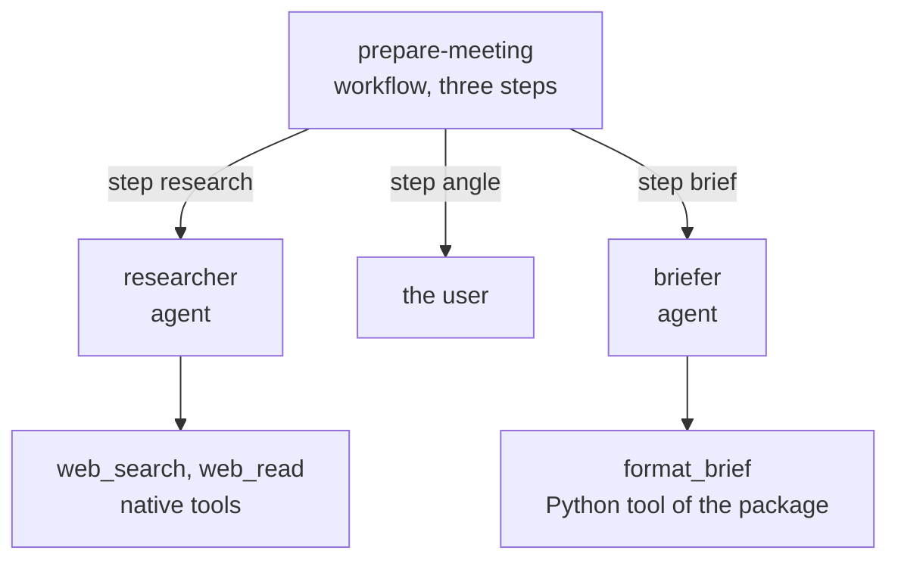
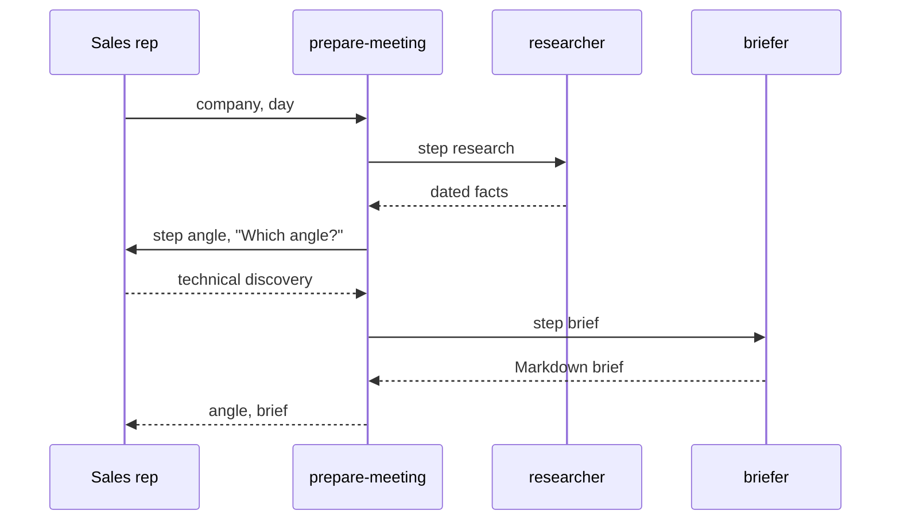

# Construire un assistant multi-agents

Ce tutoriel avancé présente un paquet complet : un assistant de préparation de
rendez-vous commerciaux. Un commercial donne une entreprise et une date et,
quelques minutes plus tard, reçoit une note en Markdown à lire avant l'appel.
Derrière ce lancement unique se trouvent deux agents, un outil Python et un
workflow qui les enchaîne.

Vous devriez déjà avoir construit
[votre premier agent](/tutorials/your-first-agent). Comptez environ
quarante-cinq minutes.

## Ce que vous allez construire

Le commercial lance le workflow avec une entreprise et un jour :

```sh
apollia-os workflow run meeting-prep/prepare-meeting --input company="Acme Corp" --input day=2026-11-03 --wait
```

Le workflow se renseigne sur l'entreprise, demande au commercial sous quel
angle aborder le rendez-vous, et rend quelque chose comme :

```markdown
# Meeting with Acme Corp, 2026-11-03

## What we know
- 2026-09-12: opened a second production site in Lyon (acme.example/news)
- 2026-08-30: hired a head of IT (acme.example/team)

## Questions to ask
1. What does the second site change for your planning?
2. Has the new head of IT set a roadmap?
3. Where does the current system slow you down?
```

## Architecture

Un paquet, quatre éléments, une responsabilité chacun.



| Élément | Nature | Où il est écrit | Ce qu'il fait |
|---|---|---|---|
| `researcher` | agent | `apollia.toml` | Se renseigne sur une entreprise sur le web public |
| `briefer` | agent | `apollia.toml` | Choisit les faits, rédige les questions, appelle l'outil de mise en forme |
| `format_brief` | outil | `tools/brief.py` | Met la note en forme en Markdown |
| `prepare-meeting` | workflow | `flows/prepare.py` | Enchaîne les deux agents, avec une question à l'utilisateur entre les deux |

Le découpage suit une règle. Ce qui demande du jugement est un agent : une
mission et les outils qu'il peut appeler. Ce qui doit sortir de la même façon
à chaque fois est du Python : un outil quand c'est un agent qui décide de
l'appeler, un workflow quand l'ordre des étapes est fixé d'avance.



Le dossier du paquet, une fois terminé :

```text
meeting-prep/
  apollia.toml
  tools/brief.py
  flows/prepare.py
  tests/test_prepare.py
```

## Étape 1 : déclarer les deux agents

Créez le dossier `meeting-prep` et son `apollia.toml` :

```toml
[package]
name = "meeting-prep"
version = "0.1.0"
publisher = "You"
description = "Prepares a sales meeting: public research on the company, then a brief to read before the call."
sdk = ">=0.3.0"

[[agents]]
id = "researcher"
name = "Researcher"
mission = """
Research a company on the public web. Search, then read the two or three most
relevant pages, primary sources first. Answer with a list of dated facts, one
per line, each followed by the address of the page it comes from. Report only
what the pages say. When you find nothing, say so.
"""
examples = [
    "What happened at Acme Corp in the last three months?",
]

[agents.defaults]
access = ["web_search", "web_read"]
autonomy = "supervised"

[[agents]]
id = "briefer"
name = "Briefer"
mission = """
Turn research notes into a meeting brief. From the notes you are given, pick
the facts that matter for the meeting and write three to five questions to
ask. Then call the tool `format_brief` with the company, the date, the facts
and the questions, and answer with the Markdown it returns, unchanged.
"""

[agents.defaults]
access = ["pkg:meeting-prep/format_brief"]
planning = "never"
```

Chaque agent ne reçoit que ce dont sa mission a besoin. `researcher` atteint
deux outils natifs du runtime, nommés tels quels ; `briefer` atteint un outil
de ce paquet, nommé `pkg:<package>/<tool>`. Aucun des deux ne peut appeler ce
que l'autre détient.

Deux valeurs par défaut apparaissent ici à côté de `access`. `autonomy` est le
palier auquel l'agent s'exécute : à partir de `supervised`, le runtime
vérifie le résultat d'une exécution avant de l'accepter, ce qui vaut son coût
pour une recherche. `planning` dit si l'agent écrit un plan avant d'agir
(`never`, `auto` ou `always`) ; `briefer` n'a qu'un outil à appeler et n'en a
pas besoin. Les deux sont des recommandations que la personne peut remplacer,
comme toute valeur par défaut. Voir
[Les paliers d'autonomie](/explanation/autonomy-tiers).

## Étape 2 : écrire l'outil de mise en forme

La note doit avoir la même présentation à chaque fois : la présentation est
donc du code, et non une demande adressée à un modèle. Créez
`meeting-prep/tools/brief.py` :

```python
"""The formatting tool of the package meeting-prep."""

from typing import Annotated

from apollia import DomainError, tool
from apollia.types import Ctx


@tool(
    "format_brief",
    "Lay a meeting brief out in Markdown, from its facts and its questions.",
    action="read",
    examples=[
        {
            "company": "Acme Corp",
            "date": "2026-11-03",
            "facts": ["2026-09-12: opened a second site in Lyon (acme.example/news)"],
            "questions": ["What does the second site change for your planning?"],
        }
    ],
)
async def format_brief(
    ctx: Ctx,
    company: Annotated[str, "The company the meeting is with."],
    date: Annotated[str, "The day of the meeting, as YYYY-MM-DD."],
    facts: Annotated[list[str], "The facts to keep, one per item."],
    questions: Annotated[list[str], "The questions to ask, one per item."],
) -> dict[str, str]:
    if not facts:
        raise DomainError("NO_FACTS", "a brief needs at least one fact")
    ctx.logger.info("format_brief: %d facts, %d questions", len(facts), len(questions))
    lines = [f"# Meeting with {company}, {date}", "", "## What we know"]
    lines += [f"- {fact}" for fact in facts]
    lines += ["", "## Questions to ask"]
    lines += [f"{n}. {question}" for n, question in enumerate(questions, 1)]
    return {"markdown": "\n".join(lines)}
```

`DomainError` est la façon dont un outil refuse : un code stable sur lequel
l'appelant peut se brancher, et un message. L'agent qui a appelé l'outil lit
le refus.

<!-- claim:secrets-gated-by-manifest-declaration -->

Cet outil n'a besoin d'aucun identifiant, et un paquet n'en livre jamais. Un
outil qui lit `ctx.secrets.get("SOME_KEY")` reçoit `None` pour toute clé qui
n'a pas été accordée à son contexte, même quand une valeur est rangée sous ce
nom dans le magasin : il doit donc traiter `None`. Un compte dont le paquet
dépend (une boîte mail, un CRM) se déclare comme une connexion requise, sous
`[[requires]]` dans `apollia.toml` : l'aperçu avant installation montre si
elle est présente ou manquante.

## Étape 3 : écrire le workflow

Un workflow est une fonction `async` sous `@workflow` qui reçoit `(ctx,
inputs)`. Ses étapes sont déclarées d'avance, dans le décorateur, et c'est
cette liste que la carte du workflow affiche sans exécuter le code. Créez
`meeting-prep/flows/prepare.py` :

```python
"""The workflow of the package meeting-prep."""

import datetime
from typing import Annotated, NotRequired, TypedDict

from apollia import LongText, WorkflowCtx, workflow
from apollia.errors import QuestionDeclined

# No `from __future__ import annotations` in this module: it would turn the
# annotations of the TypedDict into strings, and the input schema is read
# from them.

ANGLES = ["commercial follow-up", "technical discovery"]


class PrepareMeeting(TypedDict):
    """Inputs of the prepare-meeting workflow."""

    company: Annotated[str, "The company the meeting is with."]
    day: Annotated[datetime.date, "The day of the meeting."]
    context: NotRequired[Annotated[LongText, "What you already know, if anything."]]


@workflow(
    "prepare-meeting",
    "Research a company, then write the brief to read before the meeting.",
    inputs=PrepareMeeting,
    steps=["research", "angle", "brief"],
    action="read",
)
async def prepare_meeting(ctx: WorkflowCtx, inputs: PrepareMeeting) -> dict[str, str]:
    company = inputs["company"]

    async with ctx.step("research"):
        findings = await ctx.agents.run(
            "researcher",
            f"What happened at {company} in the last three months?",
        )

    async with ctx.step("angle"):
        try:
            angle = await ctx.user.ask(
                f"Which angle for the meeting with {company}?",
                options=ANGLES,
            )
        except QuestionDeclined:
            angle = ANGLES[0]

    async with ctx.step("brief"):
        brief = await ctx.agents.run(
            "briefer",
            f"Company: {company}\n"
            f"Date: {inputs['day'].isoformat()}\n"
            f"Angle: {angle}\n"
            f"Known context: {inputs.get('context', 'none')}\n"
            f"Research notes:\n{findings}",
        )

    return {"angle": angle, "brief": brief}
```

<!-- claim:skill-schema-built-from-typeddict-required-keys -->

Les entrées sont un `TypedDict`, et le formulaire de lancement en est tiré :
un texte obligatoire pour `company`, une date pour `day`, un texte long
facultatif pour `context`. Les champs obligatoires sont lus sur le `TypedDict`
lui-même à l'import du module, et c'est pourquoi
`from __future__ import annotations` est banni d'un module qui en définit un :
des annotations changées en chaînes produisent un schéma faux, pas une erreur.

Le corps ouvre chaque étape avec `async with ctx.step("name")`. Un nom que le
décorateur n'a pas déclaré est refusé : le corps ne peut pas s'écarter de la
carte. Dans une étape, trois services n'existent que pendant l'exécution d'un
workflow :

- **`ctx.agents.run(agent_id, message)`** remet un message à un agent, comme
  premier tour d'une conversation neuve, et rend sa réponse finale. L'agent
  s'exécute avec ses propres accès et dépense le budget de l'exécution.
- **`ctx.user.ask(question, options=...)`** arrête l'exécution dans l'étape
  jusqu'à ce que la personne réponde. Un refus lève `QuestionDeclined` ;
  rattrapé, le workflow continue, ici avec le premier angle.
- **`ctx.workflows.run(workflow_id, inputs)`** exécute un autre workflow comme
  une étape. Ce paquet n'en a pas besoin.

`action="read"` est la famille de la chose la plus sensible que fait le
workflow. Ici, les deux agents ne font que lire.

## Étape 4 : tester le workflow

Un workflow est lui aussi une simple fonction. `MockContext` fixe la réponse
de chaque agent et celle de l'utilisateur, et enregistre chaque appel. Créez
`meeting-prep/tests/test_prepare.py` :

```python
import asyncio
import datetime

from apollia.testing import MockContext

from flows.prepare import prepare_meeting

QUESTION = "Which angle for the meeting with Acme Corp?"


def test_prepare_meeting_hands_the_research_to_the_briefer():
    # GIVEN two agents with scripted answers and a user who picks an angle
    ctx = MockContext()
    ctx.agents.answers = {
        "researcher": "2026-09-12: opened a second site in Lyon (acme.example/news)",
        "briefer": "# Meeting with Acme Corp, 2026-11-03",
    }
    ctx.user.answers = {QUESTION: "technical discovery"}

    # WHEN the workflow is awaited as written
    result = asyncio.run(
        prepare_meeting(ctx, {"company": "Acme Corp", "day": datetime.date(2026, 11, 3)})
    )

    # THEN the briefer received the research and the chosen angle
    assert [agent for agent, _ in ctx.agents.run_calls] == ["researcher", "briefer"]
    message = ctx.agents.run_calls[1][1]
    assert "opened a second site in Lyon" in message
    assert "Angle: technical discovery" in message
    assert result == {
        "angle": "technical discovery",
        "brief": "# Meeting with Acme Corp, 2026-11-03",
    }


def test_prepare_meeting_keeps_the_first_angle_when_the_question_is_declined():
    # GIVEN a user who declines the question
    ctx = MockContext()
    ctx.user.declined = {QUESTION: None}

    # WHEN the workflow is awaited
    result = asyncio.run(
        prepare_meeting(ctx, {"company": "Acme Corp", "day": datetime.date(2026, 11, 3)})
    )

    # THEN the run goes on with the first angle
    assert result["angle"] == "commercial follow-up"
```

```sh
cd meeting-prep
python -m pytest -p no:cacheprovider tests
cd ..
```

Le test prouve l'ordre des étapes et ce qui circule de l'une à l'autre. Il ne
dit rien de ce que répond un modèle : sous `MockContext`, aucun agent ne
s'exécute.

## Étape 5 : décrire, construire et installer

```sh
python -m apollia describe meeting-prep
apollia-os package build meeting-prep
apollia-os package inspect meeting-prep-0.1.0.apo
```

`describe` écrit une entrée `[[tools]]` et une entrée `[[workflows]]` dans
`apollia.toml`, la seconde avec ses étapes et le schéma de ses entrées.
`inspect` annonce deux agents, un workflow et un outil.

Avec le runtime démarré et un modèle configuré, comme dans le premier
tutoriel :

```sh
apollia-os package preview meeting-prep-0.1.0.apo
apollia-os package install meeting-prep-0.1.0.apo
apollia-os workflow show meeting-prep/prepare-meeting
```

`preview` liste, pour chaque agent, les accès qu'il demande et ce que chacun
permet. `workflow show` affiche les étapes et chaque entrée avec son type, lus
dans le manifeste.

## Étape 6 : le lancer

Lancez le workflow et suivez-le jusqu'à sa fin :

```sh
apollia-os workflow run meeting-prep/prepare-meeting --input company="Acme Corp" --input day=2026-11-03 --wait
```

L'exécution s'arrête dans sa deuxième étape, sur la question. Répondez-y
depuis un second terminal, avec l'identifiant qu'affiche `pending` :

```sh
apollia-os approvals pending
apollia-os approvals decide <ID> answer --value "technical discovery"
```

L'exécution reprend, et `--wait` se termine sur le résultat. Dans
l'application de bureau, le même workflow a un formulaire de lancement tiré de
ses entrées.

Chaque agent fonctionne aussi seul. Rien ne lie `researcher` au workflow :

```sh
apollia-os run researcher "What happened at Acme Corp in the last three months?"
```

## Ce que vous avez construit

Un paquet où chaque élément fait une seule chose. Deux agents portent le
jugement, chacun avec une mission et les seuls outils dont il a besoin. Un
outil porte la présentation. Un workflow porte l'ordre : la recherche, une
question à la personne, la note. Les quatre s'installent, s'aperçoivent, se
mettent à jour et se retirent ensemble, en une seule archive.

## Étapes suivantes

- Ajoutez un troisième agent qui lit l'historique du compte dans une source
  que la personne a connectée, et une étape qui l'appelle entre `research` et
  `angle`.
- Découpez le workflow : déplacez la recherche dans un workflow à part et
  appelez-le avec `ctx.workflows.run`, jusqu'à trois niveaux de profondeur.
- Lisez ce que garantit chaque service de `ctx` dans la
  [référence SDK / ctx](/reference/sdk).
